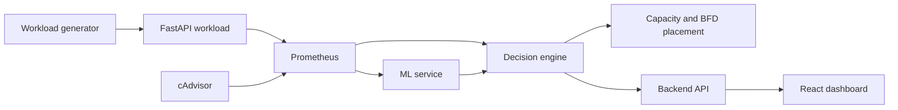

# AI-Driven Resource Provisioning System

> **Historical draft.** This document predates the Phase 5 approval and simulated
> execution workflow. Some architecture diagrams, run results, and collection
> counts below describe an earlier state and are not verified by the files now
> present. Use [README.md](README.md) for current setup, API, demonstration,
> limitations, and status; use [the Phase 3 report](ml-service/evaluation/REPORT.md)
> for model evaluation evidence. This draft is retained for project history.

## 1. Project Objective

This project is a demonstrable prototype for AI-assisted resource provisioning in an on-premises-style virtualized infrastructure. It observes a running workload, predicts near-future request rate, estimates the CPU, memory, and network demand associated with that workload, checks simulated infrastructure capacity, selects placements with Best-Fit Decreasing, and explains Random Forest predictions with SHAP.

The implemented flow is:

```text
Workload -> Prometheus/cAdvisor -> LSTM -> Random Forest -> SHAP
                                      -> Decision Engine -> BFD placement
                                      -> Backend -> React dashboard
```

The provisioning action is simulated in software. The project does not control Hyper-V, VMware, physical servers, or real virtual machines.

## 2. Problem Statement

A workload can change over time, causing future CPU, memory, and network requirements to differ from the current measurements. A provisioning system therefore needs to:

1. Observe live workload and infrastructure signals.
2. Forecast near-future request rate.
3. Estimate the resources likely to be required by that workload.
4. Compare predicted demand with available capacity and safety limits.
5. Select a feasible host for simulated workloads.
6. Explain the resource prediction in terms that a person can inspect.

This prototype addresses those steps with Prometheus, an LSTM, three Random Forest regressors, SHAP, a capacity-aware decision engine, and a Best-Fit Decreasing placement algorithm.

## 3. System Architecture

The system is divided into these service boundaries:

- **Workload service:** FastAPI application exposing `/`, `/health`, `/work`, and `/metrics`.
- **Workload generator:** Sends controlled HTTP traffic with low, medium, high, spike, decrease, and mixed phases.
- **Prometheus:** Scrapes the workload and cAdvisor at a five-second interval and serves query APIs.
- **cAdvisor:** Exposes Docker/container metrics where the host environment makes them available.
- **ML service:** FastAPI application serving LSTM workload prediction, Random Forest resource prediction, SHAP explanations, and training routes.
- **Decision engine:** Queries Prometheus, calls the ML service, checks capacity, and runs BFD placement through `/decision/live`.
- **Backend:** Node.js/Express API adapter used by the dashboard. `/api/state` calls the live decision-engine path.
- **Dashboard:** React, TypeScript, Material UI, and Recharts live control-room interface.

### Component interaction



## 4. End-to-End Data Flow

1. The workload generator sends requests to `http://localhost:8000/work`.
2. The workload exposes request counters and latency histograms on `/metrics`.
3. The workload also exposes process-derived CPU, memory, and network gauges.
4. Prometheus scrapes the workload and cAdvisor every five seconds.
5. The decision engine queries current request rate, CPU, memory, network, and latency from Prometheus.
6. The decision engine requests a 12-sample request-rate history from Prometheus.
7. The ML service `/predict/workload` uses the history and the trained LSTM to predict the next request rate.
8. The decision engine sends the LSTM prediction and current metrics to `/predict/resources`.
9. The three Random Forests predict CPU, memory, and network demand.
10. The decision engine requests `/explain/resources` for SHAP explanations of those resource predictions.
11. The predicted resource demand is passed to the capacity-aware decision logic.
12. The existing BFD function assigns supplied VMs to feasible hosts.
13. `/decision/live` returns current metrics, workload prediction, resource predictions, capacity status, decision, reason, explanation, and placement.
14. The backend exposes that response through `/api/state`.
15. The dashboard polls `/api/state` every five seconds and renders the live result.

## 5. Technology Stack

- Python 3.12 containers for workload, ML, and decision-engine services.
- FastAPI and Uvicorn for Python HTTP APIs.
- Node.js, Express, and TypeScript for the backend.
- React and TypeScript for the dashboard.
- Material UI for dashboard components.
- Recharts for the workload history/forecast chart.
- Prometheus v3.1.0 for time-series collection and querying.
- cAdvisor v0.49.1 for Docker/container metrics.
- TensorFlow CPU 2.18.0 and Keras for the LSTM.
- pandas and NumPy for data handling.
- scikit-learn RandomForestRegressor and StandardScaler for resource-demand prediction.
- SHAP TreeExplainer for Random Forest explanations.
- joblib for model and scaler persistence.
- Docker Compose for local service orchestration.

## 6. Docker Architecture

The Compose file defines seven services:

| Service | Port | Role |
|---|---:|---|
| `workload` | 8000 | FastAPI workload and Prometheus metrics |
| `ml-service` | 8001 | LSTM, Random Forest, and SHAP APIs |
| `decision-engine` | 8002 | Live ML integration, capacity, and placement |
| `backend` | 3000 | Dashboard-facing API |
| `dashboard` | 5173 | Nginx-served React application |
| `prometheus` | 9090 | Metrics storage and query API |
| `cadvisor` | 8080 | Container metrics exporter |

Compose DNS is used inside containers. For example, the decision engine reaches Prometheus at `http://prometheus:9090` and the ML service at `http://ml-service:8001`.

The cAdvisor service is configured with privileged access and read-only mounts for the host root, Docker runtime, sysfs, and Docker data directories. Availability of detailed per-container cgroup series depends on the Docker Desktop host environment.

## 7. Monitoring Architecture

### Prometheus

Prometheus scrapes:

```yaml
global:
  scrape_interval: 5s
```

The configured scrape jobs are:

- `workload` at `workload:8000`
- `cadvisor` at `cadvisor:8080`

The collector and decision engine use Prometheus HTTP API queries. A row is not written when a required query returns no series, a request error, or a non-finite value.

### Workload metrics

The workload application exports:

- `workload_requests_total{endpoint,status}`
- `workload_request_latency_seconds` histogram
- `workload_cpu_utilization_percent`
- `workload_memory_utilization_percent`
- `workload_network_throughput_bytes_per_second`

CPU, memory, and network gauges are based on the running workload process and container/cgroup information. They are not manually supplied fake values.

### cAdvisor

cAdvisor exposes Docker/container metrics such as CPU usage, working-set memory, and network counters. It is scraped and verified as a running Prometheus target. In the Docker Desktop environment used for verification, detailed per-Compose-container cgroup labels were not consistently available, so the workload application gauges are used for the workload-specific CPU, memory, and network values. This keeps the values real without inventing a container label match.

## 8. Dataset

The training dataset is `final_dataset.csv`, copied into `ml-service/data/final_dataset.csv`.

Verified dataset facts:

- Rows: `5,000`
- Columns: `timestamp`, `request_rate`, `cpu_utilization`, `memory_utilization`, `network_throughput`, `response_latency`
- Timestamp range: `2026-09-01 00:00:00` through `2026-09-01 06:56:35`
- Sampling interval: 5 seconds
- Missing values: 0
- LSTM target: `request_rate`

The live collection file is `data/raw/metrics.csv`. The verified 30-minute live collection contained 322 real rows. It is distinct from the 5,000-row training dataset used for the saved ML artifacts.

## 9. Preprocessing and Splits

The LSTM loader:

1. Reads the CSV.
2. Parses `timestamp` as UTC datetime.
3. Sorts chronologically.
4. Rejects missing timestamps or missing request-rate values.
5. Rejects duplicate timestamps.

The LSTM uses a chronological 70/15/15 split:

- Train: 3,500 rows
- Validation: 750 rows
- Test: 750 rows

The LSTM `MinMaxScaler` is fitted only on the training request-rate values. The default lookback window is 12 observations, equivalent to one minute at the five-second sampling interval.

The Random Forest training data uses the same chronological source data and removes the final next-step target alignment. Its resulting supervised split is:

- Train: 3,490 rows
- Validation: 748 rows
- Test: 749 rows

The Random Forest `StandardScaler` is fitted only on the training features and saved as `rf_scaler.joblib`.

## 10. LSTM Workload Prediction

### Methodology

The LSTM receives the previous 12 request-rate observations and predicts the next request rate. The target is one step ahead of the input window.

### Input and output

Input shape:

```text
(batch, 12, 1)
```

Output:

```text
next request_rate in requests per second
```

### Training configuration

- LSTM units: 32
- Dense output: 1
- Optimizer: Adam
- Learning rate: 0.001
- Loss: mean squared error
- Epoch limit: 30
- Batch size: 32
- Early stopping: validation loss patience of 5 with best-weight restoration
- Random seed: 42

### Actual held-out test metrics

These values are read from `ml-service/models/lstm_metrics.json`:

| Metric | Value |
|---|---:|
| MAE | 2.0416000457 |
| RMSE | 2.5738524450 |
| R² | 0.6886827544 |

### LSTM artifacts

- `ml-service/models/lstm_model.keras`
- `ml-service/models/lstm_scaler.joblib`
- `ml-service/models/lstm_metrics.json`

## 11. Random Forest Resource Prediction

### Methodology

Three separate `RandomForestRegressor` models are trained:

- CPU utilization
- Memory utilization
- Network throughput

Each supervised row uses current information at time `t` to predict the resource target at time `t+1`. The first feature is the request rate predicted by the already-trained LSTM from the preceding 12 request-rate values.

### Input features

The RF feature vector is:

1. `predicted_request_rate`
2. `current_request_rate`
3. `cpu_utilization`
4. `memory_utilization`
5. `network_throughput`
6. `response_latency`

### Targets

- CPU model target: next-step `cpu_utilization`
- Memory model target: next-step `memory_utilization`
- Network model target: next-step `network_throughput`

### Configuration

- Estimators: 200 trees per model
- `random_state`: 42
- `min_samples_leaf`: 2
- `n_jobs`: -1
- Preprocessing: training-only `StandardScaler`

### Actual held-out test metrics

Values are read from `ml-service/models/rf_metrics.json`.

| Target | MAE | RMSE | R² |
|---|---:|---:|---:|
| CPU utilization | 3.3971977089 | 4.2544175750 | 0.6148557703 |
| Memory utilization | 3.0104481705 | 3.7640093627 | 0.6411002842 |
| Network throughput | 17000.9940074990 | 21479.4604327038 | 0.4956810417 |

The network errors are in the dataset's network-throughput units, bytes per second.

### Random Forest artifacts

- `ml-service/models/rf_cpu.joblib`
- `ml-service/models/rf_memory.joblib`
- `ml-service/models/rf_network.joblib`
- `ml-service/models/rf_scaler.joblib`
- `ml-service/models/rf_metrics.json`

## 12. SHAP Explainability

The ML service uses `shap.TreeExplainer` on each trained Random Forest. Before explanation, the input vector is passed through the same fitted `rf_scaler.joblib` used during RF inference. The response includes the model prediction, base value, raw input values, signed contribution, direction, feature names, and ranked absolute importance.

SHAP values explain the model output for the supplied input. They do not prove that a feature causes the physical resource behavior.

### Actual verified CPU example

Input:

```json
{
  "predicted_request_rate": 28.5,
  "current_request_rate": 25.7,
  "cpu_utilization": 42.0,
  "memory_utilization": 57.0,
  "network_throughput": 198000.0,
  "response_latency": 47.0
}
```

The running API returned:

```text
prediction: 46.6662589981
base_value: 42.2756342875
predicted_request_rate: +5.2024438504 (positive)
current_request_rate: -0.5973511072 (negative)
cpu_utilization: +0.0564332943 (positive)
memory_utilization: +0.0434598787 (positive)
network_throughput: -0.2403745205 (negative)
response_latency: -0.0739866851 (negative)
```

## 13. Capacity-Aware Decision Engine

The live route is `POST /decision/live`. It queries Prometheus, calls all three ML APIs, and passes the RF predictions into `assess_capacity`.

The implemented capacity rules are:

1. Compute aggregate remaining physical capacity from the supplied hosts.
2. Compute safe capacity as total host capacity multiplied by `safety_threshold`, minus allocated resources.
3. If predicted demand exceeds physical capacity, return `OVERLOAD`.
4. Otherwise, if predicted demand exceeds safe capacity, return `SCALE_UP`.
5. Otherwise, return `HOLD`.

The current `capacity.py` implementation produces `HOLD`, `SCALE_UP`, and `OVERLOAD` directly. `SCALE_DOWN` exists in `scaling.py` as a helper for a HOLD decision with low utilization, but the live route does not currently invoke that helper. `REBALANCE` is not implemented as an active branch in the current decision engine. It should not be claimed as a currently generated live decision.

## 14. Best-Fit Decreasing Placement

The existing `place_vms` function is preserved. It:

1. Sorts VMs in descending order by their largest resource requirement, then by VM ID.
2. Finds hosts with enough remaining CPU, memory, and network for the VM.
3. Computes a normalized waste score for each feasible host.
4. Chooses the lowest-waste host, breaking ties by host ID.
5. Updates host allocations and records the VM-to-host assignment.
6. Reports unplaced VMs when no host is feasible.

The live decision response includes `placements`, `unplaced`, and remaining host capacity.

## 15. Live ML to Decision-Engine Integration

The decision engine's `integration.py` performs the following real calls:

1. Prometheus instant queries for current request rate, CPU, memory, network, and latency.
2. Prometheus range query for the latest 12 request-rate samples.
3. ML `/predict/workload`.
4. ML `/predict/resources`.
5. ML `/explain/resources`.
6. Capacity assessment using the RF outputs.
7. BFD placement using the supplied host and VM objects.

The response contains current metrics, predicted workload, predicted CPU, memory, and network, capacity status, decision, reason, SHAP explanation, and placement.

## 16. API Endpoints

### Workload service

- `GET http://localhost:8000/`
- `GET http://localhost:8000/health`
- `GET http://localhost:8000/work`
- `GET http://localhost:8000/metrics`

### ML service

- `GET http://localhost:8001/health`
- `POST http://localhost:8001/predict/workload`
- `POST http://localhost:8001/predict/resources`
- `POST http://localhost:8001/explain/resources`
- `POST http://localhost:8001/explain/resources/{resource}`
- `POST http://localhost:8001/train/lstm`
- `POST http://localhost:8001/train/random-forest`

### Decision engine

- `GET http://localhost:8002/health`
- `POST http://localhost:8002/decision`
- `POST http://localhost:8002/decision/live`
- `POST http://localhost:8002/placement`

### Backend

- `GET http://localhost:3000/api/health`
- `GET http://localhost:3000/api/metrics`
- `GET http://localhost:3000/api/infrastructure`
- `GET http://localhost:3000/api/state`
- `GET http://localhost:3000/api/prediction`
- `GET http://localhost:3000/api/decision`
- `GET http://localhost:3000/api/placement`
- `GET http://localhost:3000/api/explanation`
- `GET http://localhost:3000/api/events`

### Monitoring

- `GET http://localhost:9090/-/ready`
- Prometheus query API: `http://localhost:9090/api/v1/query`
- cAdvisor metrics: `http://localhost:8080/metrics`

## 17. Dashboard Functionality

The React dashboard is served at `http://localhost:5173` and polls `http://localhost:3000/api/state` every five seconds.

It displays:

- Current request rate, CPU, memory, and network metrics.
- Historical request rate versus LSTM forecast.
- RF predicted CPU, memory, and network demand compared with available capacity.
- Current decision, bottleneck, and reason.
- Host utilization and physical capacities.
- VM assignments and selected hosts from BFD.
- CPU, memory, and network SHAP contributions and ranked importance.
- A timeline containing live metrics, LSTM, RF, decision, and placement events.

## 18. Verified Results

The implementation was verified with running Docker services.

### Data collection

The changing workload scenario completed with 18,836 successful requests out of 18,838 total requests during the verified 30-minute scenario. The collector saved 322 valid rows to `data/raw/metrics.csv`; rows with unavailable or non-finite Prometheus values were skipped.

### Live decision examples

A normal-capacity test returned `HOLD` with real values including:

- Current request rate: `9.1796469367`
- LSTM predicted request rate: `7.359`
- RF predicted CPU: `17.8352`
- RF predicted memory: `35.0501`
- RF predicted network: `103466.8267`
- BFD assigned both test VMs to `host-large-1`

A tight-capacity test returned:

- Decision: `SCALE_UP`
- Bottleneck: `cpu`
- Reason: predicted CPU demand exceeded safe capacity
- `vm-web` assigned to `host-scale-1`
- `vm-worker` and `vm-small` assigned to `host-scale-2`

An insufficient-capacity test returned:

- Decision: `OVERLOAD`
- Bottleneck: `network`
- Reason: predicted network demand exceeded physical capacity

A browser-level dashboard verification displayed a real `OVERLOAD` state with live metrics, LSTM prediction, all three RF predictions, all three SHAP panels, three BFD assignments, and the event timeline.

These are functional integration results, not additional ML accuracy measurements.

## 19. Limitations

- The infrastructure is simulated with Python host and VM objects.
- No real VM creation, migration, shutdown, or physical provisioning occurs.
- `REBALANCE` is not currently generated by the active decision logic.
- `SCALE_DOWN` exists as a helper but is not wired into `/decision/live`.
- The dashboard uses a fixed in-memory host/VM demonstration configuration from the backend.
- Prometheus/cAdvisor label availability depends on the Docker Desktop host environment.
- The RF network target has a lower R² than the CPU and memory targets in the measured test.
- SHAP explains the trained model output for an input; it is not causal analysis.
- Events and chart history are held in backend memory and reset when the backend restarts.
- No energy consumption or energy savings were measured.
- The project does not claim production accuracy, production scaling policy, or physical infrastructure control.

## 20. Reproduction

Prerequisites:

- Docker Desktop with the Linux engine running.
- Python for host-side workload and collection scripts.
- Node.js and npm for local frontend/backend builds if needed.

From the project root:

```powershell
docker compose up --build
```

For real data collection, use separate terminals:

```powershell
python data\collection\collect_metrics.py --duration 1800 --interval 5
```

```powershell
python data\collection\workload_scenario.py --url http://localhost:8000/work --phase-duration 300
```

The scenario runs `low -> medium -> high -> spike -> decrease -> mixed`. The collected CSV is `data/raw/metrics.csv`.

To train the LSTM using the staged final dataset:

```powershell
docker compose exec -T ml-service python training/train_lstm.py --dataset /app/data/final_dataset.csv --epochs 30 --window 12
```

To train the Random Forest models:

```powershell
docker compose exec -T ml-service python training/train_random_forest.py --dataset /app/data/final_dataset.csv --window 12
```

To build the backend and dashboard locally:

```powershell
Push-Location backend; npm run build; Pop-Location
Push-Location dashboard; npm run build; Pop-Location
```

To view the live dashboard, open `http://localhost:5173`. To inspect the browser-facing live snapshot, use:

```powershell
Invoke-RestMethod http://localhost:3000/api/state
```

## 21. Project Directory Structure

```text
ai-resource-provisioning/
├── backend/
│   └── src/
│       ├── routes/api.ts
│       ├── services/orchestration.ts
│       ├── types/index.ts
│       └── server.ts
├── dashboard/
│   └── src/
│       ├── App.tsx
│       ├── main.tsx
│       └── styles.css
├── data/
│   ├── collection/
│   │   ├── collect_metrics.py
│   │   └── workload_scenario.py
│   └── raw/metrics.csv
├── decision-engine/
│   ├── capacity.py
│   ├── integration.py
│   ├── main.py
│   ├── models.py
│   ├── placement.py
│   ├── scaling.py
│   └── tests/test_engine.py
├── ml-service/
│   ├── data/final_dataset.csv
│   ├── models/
│   ├── prediction/
│   ├── training/
│   ├── main.py
│   ├── preprocessing.py
│   └── tests/
├── monitoring/prometheus.yml
├── workload-generator/
│   ├── app.py
│   └── generator.py
├── docker-compose.yml
├── final_dataset.csv
└── README.md
```
